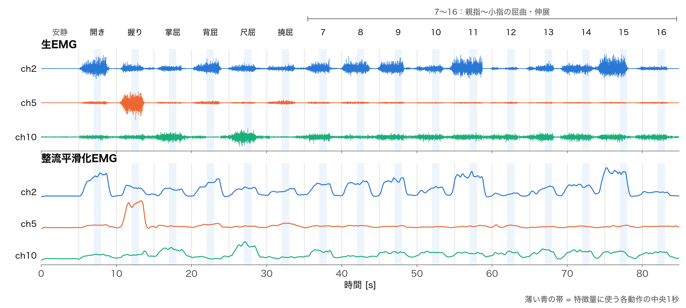
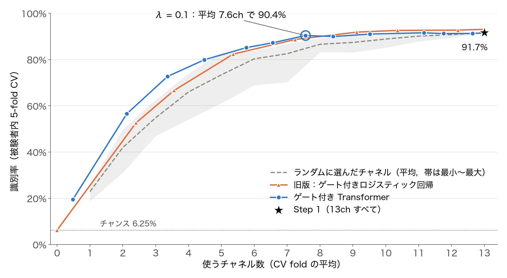
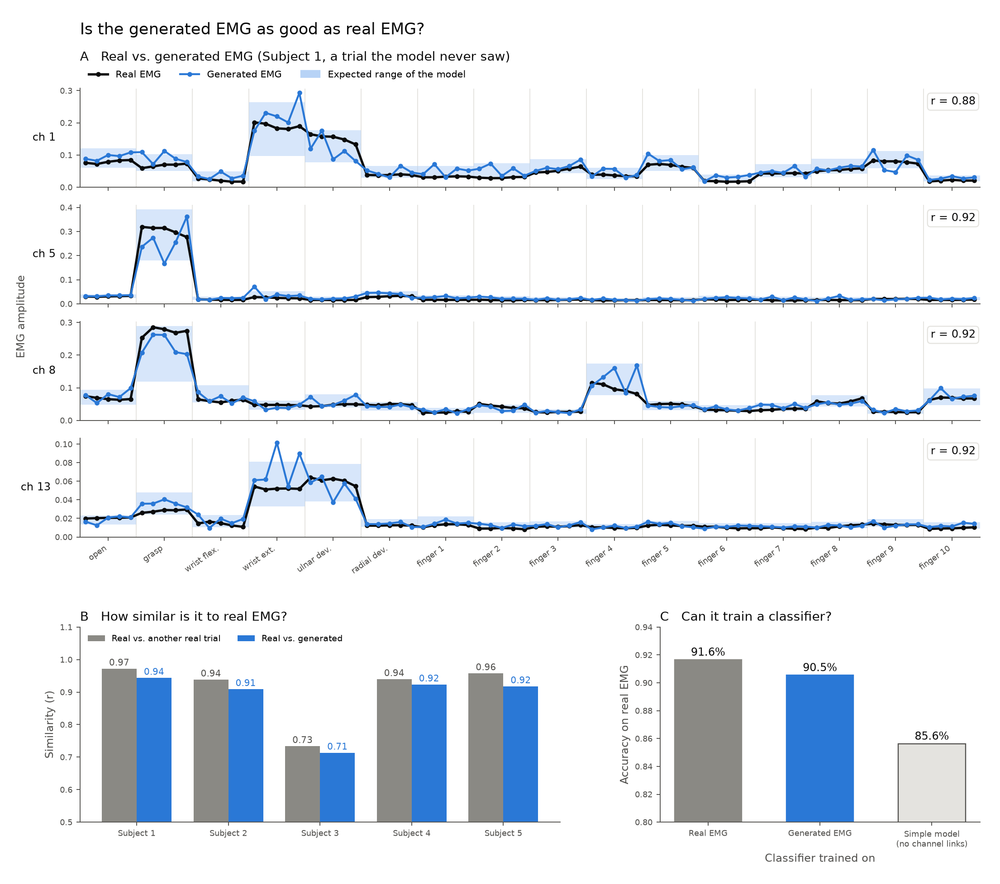
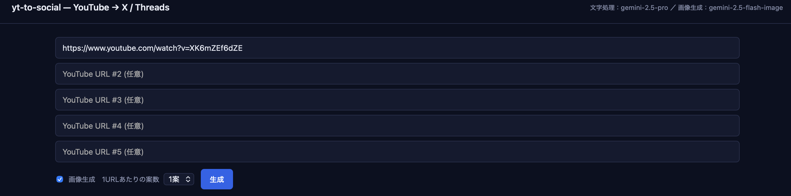

# Portfolio — Ganbaatar Bayartulga（ガンバートル バヤラトルガ）

大阪大学で **パターン認識・機械学習** の研究をしています。
このリポジトリは、研究と個人開発の成果をまとめたポートフォリオです。

| | 内容 | 主な技術 |
|---|---|---|
| 🔬 [**Research**](Research/) | 筋電位（EMG）の電極配置を AI に自動設計させる研究 | Python / PyTorch / scikit-learn, Transformer, L0 正則化, 生成モデル |
| 🛠 [**yt-to-social**](yt-to-social/) | YouTube 動画から X / Threads の投稿文と画像を生成し、ワンクリックで投稿するアプリ | FastAPI, Gemini API, Claude API, X / Threads API, Pillow |

---

## 🔬 Research — 筋電センサを「どこに・何個」貼ればよいか、AI に決めさせる

**微分可能なデータ収集にもとづく、筋電位（EMG）の電極配置の自動設計**

📄 詳細資料: [Research_Portfolio_Bayartulga.pdf](Research/Research_Portfolio_Bayartulga.pdf)（全 7 ページ、専門外の方にも読める説明）

筋肉は動くときに微弱な電気（筋電位）を出します。これを皮膚に貼った電極で読み取れば、義手やロボット、VR をジェスチャで操作できます。ただ、**電極をどこに何個貼るか** は、これまで研究者の経験と試行錯誤で決められてきました。

本研究では電極の配置そのものを学習対象にし、「動作をどれだけ正しく見分けられるか」と一緒に最適化します。研究室の早志 英朗 先生が提唱する **微分可能なデータ収集（Differentiable Data Collection）** の具体的な応用のひとつです。



### 主な結果（5 名・16 動作・13 電極のデータ）

| 指標 | 結果 |
|---|---|
| 13 電極すべてを使ったときの 16 動作の識別率 | **91.7%** |
| AI が電極を平均 7.6 個に絞ったときの識別率 | **90.4%**（電極 約 4 割減、−1.3 ポイント） |
| 生成した「人工の筋電」だけで学習したときの識別率 | **90.5%**（本物で学習した場合は 91.6%） |



### 研究の 4 ステップ

1. **基準をつくる**（完了）: 13 電極すべてを使って 16 動作を識別するベースライン
2. **AI が電極を選ぶ**（完了）: 各電極にスイッチ（L0 正則化 / hard concrete 分布）をつけ、Transformer が学習中に不要な電極を自分で切る。電極が 3 個前後のとき、ランダムに選ぶ場合より約 20 ポイント高い
3. **デジタルの腕**（完了）: 「この位置に貼って、この動作をしたら、どんな信号が出るか」を生成する代理モデル。TabM アンサンブルと mixup を使い、電極間の相関も表現する
4. **すべてを同時に最適化**（取り組み中）: デジタルの腕の上で、電極の位置・個数と識別 AI をまとめて学習する



### 現時点の限界

- 電極のない位置の信号予測は、まだ両隣の平均と同程度の精度
- 電極のない位置では不確かさを小さく見積もりすぎる（90% 予測区間の実際の被覆率は 49%）
- データの電極が前腕 1 周分だけなので、腕の長さ方向（z）はまだ最適化できない
- 参加者は 5 名で、モデルは参加者ごとに作っている

### 使った技術

| 分野 | 内容 |
|---|---|
| 信号処理 | 筋電の整流・平滑化、区間ごとの特徴量抽出 |
| 機械学習 | ロジスティック回帰、Transformer、L0 正則化（hard concrete 分布）による変数選択 |
| 生成モデル | 条件付き確率モデル、TabM アンサンブル、mixup によるデータ拡張、不確かさの評価 |
| 評価・再現性 | 5 分割交差検証、ランダム選択との比較、自動テスト、Python / PyTorch / scikit-learn |

> 研究コードとデータは非公開です。公開しているのは資料（PDF）と図のみです。

---

## 🛠 yt-to-social — YouTube 動画から SNS 投稿を自動生成

📁 詳細: [yt-to-social/README.md](yt-to-social/README.md)

YouTube 動画の字幕から **X / Threads 向けの投稿文と画像** を生成し、ブラウザでプレビュー・編集してワンクリックで投稿できるアプリです。外部の SaaS を使わず、Gemini API と X / Threads の公式 API だけで動きます。Gemini は無料枠の範囲で運用しています。

| GUI ランチャー | Web UI |
|---|---|
|  |  |

### 機能

- **字幕取得**: `yt-dlp` を主に使い、失敗時は `youtube-transcript-api` に切り替える。取得した字幕はキャッシュする
- **投稿文生成**: トーン、媒体ごとのフォーマット、NG 事項をまとめた戦略ドキュメント（Claude Skill 形式の `SKILL.md`）をシステムプロンプトに入れ、`gemini-2.5-pro` に構造化 JSON で出力させる
- **画像生成**: 2 層構造。図やアイコンは Gemini（Nano Banana）に描かせ、日本語の見出しやフッターは Pillow で後から合成する。画像生成モデルは漢字やブランド名のスペルが崩れやすいため、文字は描かせない
- **投稿**: X（tweepy / OAuth 1.0a）と Threads Graph API。`DRY_RUN` モードあり
- **使いやすさ**: ターミナルなしで起動できる GUI ランチャー、最大 5 本の URL の並列処理、生成画像の自動クリーンアップ

### 就活ニュース下書き生成（jobnews）

同じリポジトリ内のサブアプリです。

1. 固定した YouTube チャンネルの動画と字幕を SQLite に取り込む
2. DuckDuckGo News で直近の就活ニュースを集め、記事本文をスクレイピングする
3. Claude API で各記事と動画コーパスの関連度を判定し、関連する動画を紹介する X / Threads の下書きを作る（動画コーパスはプロンプトキャッシュに載せる）

### アーキテクチャ

```
YouTube URL
   ├── yt-dlp / youtube-transcript-api → 字幕 + メタデータ
   ▼
Gemini (SKILL.md をシステムプロンプトに注入, structured output)
   ▼
{ x_posts:[…], threads_posts:[…] }
   ▼
Gemini Image (図) + Pillow (日本語テキストを合成) → 1:1 インフォグラフィック
   ▼
FastAPI + 単一 HTML のプレビュー UI
   ▼
[X に投稿] / [Threads に投稿]
```

### クイックスタート

```bash
cd yt-to-social
cp .env.example .env    # GOOGLE_API_KEY などを記入
uv sync
python launcher.py      # GUI から起動 → http://127.0.0.1:8000
```

---

## リポジトリ構成

```
Portfolio/
├── Research/
│   ├── Research_Portfolio_Bayartulga.pdf   # 研究ポートフォリオ（PDF）
│   └── figures/                            # README 用の図
└── yt-to-social/                           # SNS 投稿生成アプリ（詳細は内部の README）
    ├── launcher.py
    ├── server/          # FastAPI / 生成 / 画像 / 投稿 / jobnews
    ├── web/             # プレビュー UI
    ├── scripts/
    └── .claude/skills/  # 生成戦略ドキュメント（SKILL.md）
```

## Contact

- **Name**: Ganbaatar Bayartulga（ガンバートル バヤラトルガ）
- **Affiliation**: 大阪大学
- **GitHub**: [@BBBlackBerry](https://github.com/BBBlackBerry)
