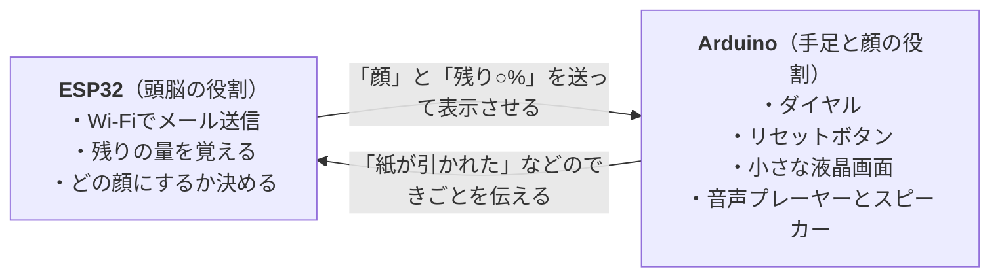

# 自己主張が強いトイレットペーパー

> 自らの「命」の終わりが近づくにつれて感情をあらわにし、必死に存在を訴えかける「自己主張が強いトイレットペーパー」の物語です。

2025年に授業の実験として作った、小さな電子工作の作品です。

トイレットペーパーホルダーが、紙があとどれくらい残っているかを数えます。紙が減るほどトイレットペーパーは感情的になり、

- 小さな画面に表示される **顔** が変わる
- **声** で話しかけてくる
- 紙がなくなると、補充をお願いする **メール** を送ってくる

という動きをします。

ふだん何気なく使っている物に「性格」をもたせたら、どんなふうに感じられるだろう？ ただ数字で残りの量を表示するのではなく、トイレットペーパー自身に訴えかけさせてみよう、というのがこの作品のアイデアです。

---

## どんなふうに動くの？

| 紙の残り | 画面の顔 | ほかに起きること |
|---|---|---|
| 81〜100% | `(^o^)` | 新しいロールに交換したとき（100%）に音声が流れる |
| 51〜80% | `(^_^;)` | |
| 21〜50% | `(o_o;)` | 残りが50%になったときに音声が流れる |
| 1〜20% | `(T_T)` | 残りが10%になったときに音声が流れる |
| 0% | `(; ;)` | 「【緊急通知】TPがゼロになりました！」というメールが届く |

- **紙を引き出すと** ロールと一緒にダイヤル（ロータリーエンコーダー）が回り、1目盛りごとに残りが5%ずつ減ります。逆向きに回すと1%ずつ増やせます（細かい調整用）。
- **ロールを交換したら** ボタンを押すと、残りが100%に戻ります。
- **メールは1ロールにつき1回だけ** 送られます。ボタンで100%に戻すと、次に0%になったときにまた送られます。

---

## 使った部品

2つの小さなコンピューター（マイコン）で役割を分けています。2つは **I²C（アイ・スクエアド・シー）** という方式の配線でつながっていて、短いデータをやり取りします。

| 部品 | 役割 |
|---|---|
| ESP32 | 全体の判断をするマイコン。Wi-Fiにつながり、Gmailでメールを送る |
| Arduino | ダイヤルとボタンを読み取り、画面と音を動かすマイコン |
| ロータリーエンコーダー（ダイヤル） | 紙がどれだけ引き出されたかを数える |
| 押しボタン | 「新しいロールに交換したよ」と知らせる |
| 液晶画面（8文字×2行） | 顔と残りの%を表示する |
| DFPlayer Mini（音声プレーヤー）＋スピーカー | microSDカードに入れた音声を再生する |
| 近接センサー（APDS-9930） | 準備だけして、最終的には使っていない |

---

## プログラム

| ファイル | 動かす場所 | 内容 |
|---|---|---|
| [`task4esp32.ino`](task4esp32.ino) | ESP32 | Wi-Fiにつなぐ。0.05秒ごとにArduinoへ「何か起きた？」と聞き、残りの量を計算して顔を決め、表示する内容をArduinoへ送る。0%になったらメールを送る。 |
| [`task4-arduino.ino`](task4-arduino.ino) | Arduino | ダイヤルとボタンの動きをESP32に伝える。ESP32から届いた顔と%を画面に出し、100%・50%・10%になったときに音声を流す。 |
| [`credentials.example.h`](credentials.example.h) | ESP32 | Wi-FiやGmailの設定を書くためのひな形 |

### 使ったライブラリ（プログラムの部品集）

- **ESP32側：** `WiFi`、`Wire`、[`ESP_Mail_Client`](https://github.com/mobizt/ESP-Mail-Client)、`APDS9930`
- **Arduino側：** `Wire`、`SoftwareSerial`、`LiquidCrystal`、[`DFRobotDFPlayerMini`](https://github.com/DFRobot/DFRobotDFPlayerMini)、`RotaryEncoder`

### 動かし方

1. `credentials.example.h` をコピーして `credentials.h` という名前にし、自分のWi-Fiの名前とパスワード、Gmailのアドレス、[Gmailのアプリパスワード](https://support.google.com/accounts/answer/185833?hl=ja) を書き込みます。
   **`credentials.h` にはパスワードが入るので、GitHubなどに絶対にアップロードしないでください。**（このフォルダでは自動的にアップロード対象から外れるよう設定しています）
2. 音声プレーヤー用のmicroSDカードに、次の3つの音声ファイルを入れます。
   - `0001.mp3`：残り10%のとき
   - `0002.mp3`：残り50%のとき
   - `0003.mp3`：新しいロールに交換したとき
3. `task4-arduino.ino` をArduinoに、`task4esp32.ino` をESP32に書き込みます。2つのマイコンの SDA・SCL・GND をそれぞれ線でつなぎます。

---

## 注意点・課題

授業中の短い実験として作ったもので、完成品ではありません。

- **残りの量は推測です。** 実際に紙の量を測っているのではなく、ダイヤルが回った回数から計算しているので、だんだんずれていきます。近接センサーは準備まではしていますが、最終的なプログラムでは使っていません。
- **ピンの割り当てが重なっています。** プログラム上で、音声プレーヤーと液晶画面が同じピン（10番と11番）を使っています。実際に組み立てるときは、どちらかを空いているピンに移す必要があります。
- **Wi-Fiがないと動きません。** ESP32は、Wi-Fiにつながるまで次の処理に進みません。
- **セリフは音声ファイルの中だけにあります。** ESP32のプログラムにある `dialogue`（セリフ）の欄は空のままで、実際のセリフは音声ファイルとして用意しています。
