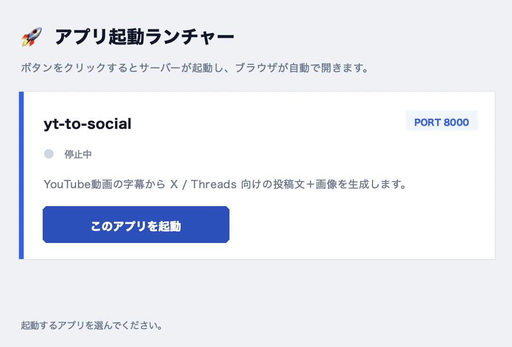
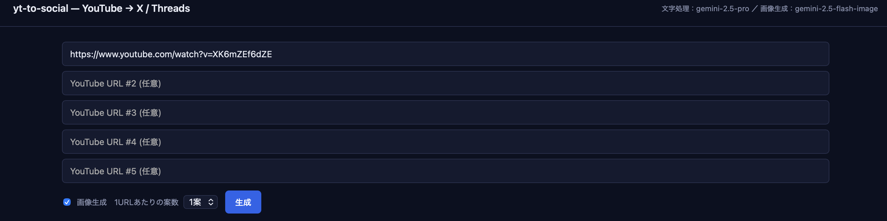

# yt-to-social

YouTube動画の字幕から **X / Threads** 向けの投稿文＋画像を生成し、プレビューしてワンクリックで投稿するアプリ。

**Claude Skill** に戦略ドキュメント（トーン＆マナー、媒体別フォーマット、NG事項）を内包し、外部SaaSを使わず Google Gemini API + X/Threads公式API のみで完結します (投稿文・画像とも Gemini)。

> 💰 **Gemini API は無料枠で運用しています。** 投稿文生成は無料枠の中で最も高性能な `gemini-2.5-pro` (5 RPM / 100 RPD)、画像生成も無料枠対応モデルを既定にしています。Google Cloud で Billing を有効化していない API キーであれば、Gemini 側の課金は発生しません (代わりに RPM / RPD の上限あり)。

## アーキテクチャ

```
YouTube URL
   │
   ├── yt-dlp                  → 字幕取得 (主) + タイトル/サムネ
   ├── youtube-transcript-api  → 字幕取得 (フォールバック)
   ├── output/transcript_cache → 取得済み字幕のキャッシュ
   ▼
Gemini API (Skillをsystem promptに注入, structured output)
   ▼
   { x_posts:[…], threads_posts:[…] }   ← 構造化JSON
   ▼
Google Gemini Images API (gemini-2.5-flash-image / Nano Banana・無料枠OK) → 1:1 雑誌風インフォグラフィック画像を直接生成
   ▼
FastAPI + 単一HTMLのプレビューUI
   ▼
[Xに投稿] / [Threadsに投稿] ボタン
   │
   ├── tweepy              → X (OAuth1.0a)
   └── Threads Graph API   → コンテナ作成 → publish
```

> 投稿文生成は Google Gemini で固定 (Anthropic Claude API は使用しません)。

## ディレクトリ構成

```
yt-to-social/
├── .env.example                          # APIキーのテンプレート (これを .env にコピー)
├── launcher.py                           # GUIランチャー (ターミナル不要)
├── .claude/skills/
│   └── generate-social-posts/SKILL.md    # 投稿文生成の戦略ドキュメント
├── server/
│   ├── config.py                         # .env 読み込み
│   ├── youtube.py                        # 字幕 + メタデータ取得
│   ├── generate.py                       # Gemini で投稿文生成
│   ├── image.py                          # Gemini 画像生成 (Nano Banana / 無料枠)
│   ├── post.py                           # X / Threads 投稿
│   └── app.py                            # FastAPI エンドポイント
├── web/
│   └── index.html                        # プレビューUI
├── scripts/
│   ├── run.sh                            # 起動スクリプト (launcher.py から呼ばれる)
│   └── cli.py                            # ターミナルから生成だけ確認
├── output/                               # 生成画像の保存先
└── pyproject.toml                        # uv 用
```

## クイックスタート

```bash
cd ~/projects/yt-to-social

# 1. .env を作成して APIキーを記入
cp .env.example .env
$EDITOR .env

# 2. 依存関係インストール (uv が .venv を自動生成)
uv sync

# 3. ランチャーを起動 (ターミナルを使わない方法)
python launcher.py
```

これだけで OK です。あとは **GUI のボタンを押すだけ** でブラウザが開きます。

## 使い方 — `launcher.py` から起動する

### ステップ 1: ランチャーでサーバーを起動する

`python launcher.py` を実行すると、下のような GUI が立ち上がります。



- カードのタイトルは **`yt-to-social`**、右上に **`PORT 8000`** と表示されています。
- 初期状態のステータスは `●  停止中`。**[このアプリを起動]** ボタンを押すとサーバーが立ち上がります。
- 起動後はステータスが緑の `●  実行中` に変わり、ボタン表記が **[ブラウザを開く]** に切り替わります。クリックすると既定ブラウザで `http://127.0.0.1:8000` が自動で開きます。
- 画面下部に「yt-to-social が起動しました！ブラウザを開きます。」と緑色のメッセージが出れば成功です。

> ランチャーのウィンドウを閉じるとサーバープロセスも一緒に停止します (バックグラウンドには残りません)。

### ステップ 2: Web UI で URL を入れて投稿文を生成する

ブラウザでは下のような UI が開きます。



- 画面右上のステータスバーに、現在使われている **文字処理モデル** (`gemini-2.5-pro`) と **画像生成モデル** (`gemini-2.5-flash-image`) が表示されます。
- 入力欄は **YouTube URL を最大5本まで** まとめて貼り付けられます。`#1` は必須、`#2`〜`#5` は任意です。
- **画像生成** チェックを外すとテキストだけ生成します (画像 API の無料枠を消費しません)。
- **1URLあたりの案数** で `1案 / 2案 / 3案` を選択。X と Threads でそれぞれこの数だけ案が並びます。
- **[生成]** ボタンを押すと、URLごとに並列で生成が走り、終わると **macOS の通知センターに静かな通知** が届きます (初回は通知許可ダイアログ)。

生成が終わると、動画ごとに X / Threads それぞれの投稿カードが並びます。

1. テキストは textarea で自由に編集可能 (文字数カウンタ付き、超過すると赤くなります)
2. 画像は `↻ 画像再生成` ボタンでカード単位で作り直せます
3. **[Xに投稿]** / **[Threadsに投稿]** ボタン → 確認ダイアログ → 実投稿

### 生成画像の自動クリーンアップ

`launcher.py` を起動するたびに `output/` 配下の生成画像 (`{timestamp}_{hash}.png`) を
チェックし、**累計 100 枚を超えていたら古い順に削除**します。

- 上限枚数は `launcher.py` の `MAX_KEEP_IMAGES` 定数で変更できます (既定 100)。
- 並び順はファイル名先頭の UNIX タイムスタンプで判定するため、生成順 = 古い順で安定して削除されます。
- `transcript_cache/` など、画像以外のファイルは対象外です。

### ランチャーを閉じるとどうなる？

- ランチャーから起動したサーバープロセスは、ランチャーを閉じると一緒に停止します。

### ターミナルから起動したい場合 (任意)

```bash
./scripts/run.sh           # http://127.0.0.1:8000
```

### ターミナルだけで投稿文を確認したい (任意)

```bash
uv run python scripts/cli.py "https://youtube.com/watch?v=XXXX"
```

## .env で設定するAPIキー

| 優先度 | キー | 用途 | 取得 |
|---|---|---|---|
| ★★★ | `GOOGLE_API_KEY` | Gemini (投稿文 `gemini-2.5-pro` + 画像 Nano Banana / **どちらも無料枠で利用可**) | https://aistudio.google.com/apikey |
| ★★ | `X_API_KEY` ほか4点 | X投稿 (OAuth1.0a) | https://developer.twitter.com/ |
| ★★ | `THREADS_*` 4点 | Threads投稿 | https://developers.facebook.com/ |

`DRY_RUN=true` の状態では投稿APIを叩かず stdout に出力するだけなので、Google (Gemini) だけ設定すれば即試せます。
通常は `DRY_RUN=false` で実行。

## 料金と課金ページ (2026年5月時点)

> ⚠️ 価格は各社の仕様変更で頻繁に動きます。**実際に課金する前に必ず公式ページで最新価格を確認**してください (下部 Sources を参照)。

| サービス | 必須/任意 | 料金 (2026/5) | チャージ・課金ページ |
|---|---|---|---|
| **Google Gemini API** | 必須 (投稿文 + 画像) | **本アプリは無料枠で運用 (テキスト・画像とも $0)**<br>・テキスト (`gemini-2.5-pro` 既定): **無料枠で利用可** — 5 RPM / 250K TPM / 100 RPD (無料枠で最も高性能なモデル)<br>・画像 (`gemini-2.5-flash-image` / Nano Banana 既定): **無料枠で利用可** — RPM/RPD 上限あり<br>・(参考) 有料枠に切り替えた場合の参考価格: テキスト 入力 $1.25 / 出力 $10 per 1M tokens、上位画像モデル `gemini-3-pro-image-preview` は 1K-2K 出力 $0.134/枚、4K $0.24/枚<br>　 ※ 無料枠は Google Cloud で Billing 未有効の API キーで自動適用。最新の上限は Google 公式ページで要確認 | 1. https://aistudio.google.com/apikey でキー作成 (Billing 未有効のままで OK)<br>2. 上限を上げたい場合のみ https://console.cloud.google.com/billing で Billing を有効化 |
| **X (Twitter) API** | Xに投稿する場合のみ必須 | **有料**<br>・**新規登録は Pay-Per-Use のみ** (2026/2/6〜)<br>　- 投稿作成 $0.01/post (URL付きpostは $0.20/post, 2026/4/20更新)<br>　- 読み取り $0.005/post (Owned reads $0.001)<br>・既存契約者のみ Basic **$200/月** / Pro **$5,000/月** が継続可<br>・Enterprise: $42,000/月〜 | https://developer.x.com/en/portal/products |
| **Threads Graph API (Meta)** | Threadsに投稿する場合のみ必須 | **無料 ($0)**<br>ただし `threads_basic` / `threads_content_publish` の **App Review が必須** (審査に数日)。長期トークン (60日) は定期更新が必要。 | https://developers.facebook.com/apps/ |
| **YouTube 字幕** (`yt-dlp` + `youtube-transcript-api`) | 必須 | **無料・APIキー不要** (スクレイピング) | — |
| **catbox.moe** (画像ホスティング) | Threads に画像付き投稿する場合に内部利用 | **無料** (200MB/upload 上限、寄付ベース運営) | https://catbox.moe/ |

### 最小コストで試したい場合の構成

1. `.env` で `DRY_RUN=true` → X / Threads は **APIを叩かず stdout 出力のみ** (両者の課金は発生しない)
2. **Gemini API キーを Billing 未有効のまま使う** → テキスト・画像とも無料枠で動作 (上限内なら $0)
3. UI で「画像も生成する」チェックを外す (もしくは `scripts/cli.py` を使う) → 画像生成の RPD を消費せず投稿文だけ確認可能

### 本番運用時の月額目安 (個人利用)

- **Gemini テキスト (`gemini-2.5-pro`)** : 無料枠運用なら **$0** (上限 100 RPD = 1日100動画まで)。有料枠に切り替えた場合は1動画あたり概ね $0.02〜$0.05
- **Gemini 画像** : 既定の `gemini-2.5-flash-image` (Nano Banana) なら **無料枠内** で1動画2枚 (X×1 + Threads×1) 収まる (RPD 上限注意)。Nano Banana Pro に切替えた場合は1動画2枚で **約 $0.27**
- **X 投稿** : Pay-Per-Use で1投稿なら $0.01 (URLなし) 〜 $0.20 (URL付き)
- **Threads 投稿** : $0
- → 無料枠運用なら Gemini 側は **$0**、課金は X 投稿のみ。1動画フルセットで概ね **$0.02〜$0.40**。月100動画でも X URL付き想定で $40 程度に収まる。

### 出典 (2026年5月時点で確認)

- Gemini Developer API 公式: https://ai.google.dev/gemini-api/docs/pricing
- X Developer Platform Products: https://developer.x.com/en/portal/products
- Threads (Meta Graph): https://developers.facebook.com/docs/threads/
- catbox.moe: https://catbox.moe/

### 字幕キャッシュ

一度取得した字幕は `output/transcript_cache/<video_id>.json` に保存され、
次回以降は YouTube を叩かずキャッシュから読み込みます。

## Threads 投稿の注意点

Threads Graph API は画像URLが **public到達可能** であることを要求します (Metaサーバーが画像URLにアクセスする方式)。ローカル開発では:

- A) ngrok 等でトンネリングして `https://xxxx.ngrok.io/output/xxx.png` を渡す
- B) S3/Cloudflare R2 等にアップロードしてからURLを渡す
- C) テキストのみ投稿する (画像なし)

UIから投稿する場合、現在は `window.location.origin + image_url` を渡しているため、`127.0.0.1:8000` のままでは画像投稿は失敗します。本番運用前に外部公開の方式を決めてください。

## 戦略ドキュメントを編集したい

すべての生成ロジックは `.claude/skills/generate-social-posts/SKILL.md` に集約しています。
文体・パターン・NG事項を変えたいときはこのファイルを直接編集すれば次回生成から反映されます (再起動不要、ファイル読み込みは生成時)。

## 画像生成プロンプトを変えたい

画像生成は **2層構造** になっており、編集すべき場所がレイヤーごとに分かれています。

### レイヤー構造のおさらい

1. **背景レイヤー (Gemini が描く図)** — システム図・アイコン・矢印などの「絵」のみ。日本語テキストは一切描かせない (ブランド名や漢字が崩れるため構造的に禁止)。
2. **情報レイヤー (PIL で後合成)** — バッジ / 大見出し / フッターを `server/image.py` 側で Pillow を使って焼き込む。文字化けゼロを担保する pixel-perfect な日本語はここで生成される。

### どこを変えるか

| 変えたい対象 | 編集するファイル | 該当箇所 | 反映タイミング |
|---|---|---|---|
| **動画ごとに変わる絵柄の指示** (シーン / 主役オブジェクト / 補助要素の組み立て方) | [`.claude/skills/generate-social-posts/SKILL.md`](.claude/skills/generate-social-posts/SKILL.md) | §7「画像方針」 — `image_prompt` の構成要素・良い例・禁止事項 | **次回生成から即反映** (再起動不要) |
| **動画ごとに変わる日本語テキストの仕様** (バッジ・見出し・補助情報の文字数や書き方) | [`.claude/skills/generate-social-posts/SKILL.md`](.claude/skills/generate-social-posts/SKILL.md) | 出力スキーマの `image_badge_jp` / `image_headline_jp` / `image_subhead_jp` / `image_bullets_jp` 説明 | 次回生成から即反映 |
| **全動画共通の固定スタイル** (パレット / 2D フラット縛り / 上下バンド比率 / テキスト禁止ルール) | [`server/image.py`](server/image.py) | `_GEMINI_STYLE_DIRECTIVE` (英語の固定プロンプト) | **サーバー再起動が必要** |
| **動画ごとのプロンプトの組み立て方** (SUBJECT / DIAGRAM HINTS の差し込み形式) | [`server/image.py`](server/image.py) | `_build_gemini_prompt()` | サーバー再起動が必要 |
| **後合成のレイアウト** (上下バンドの比率・余白・フォントサイズ・行送り) | [`server/image.py`](server/image.py) | `LAYOUT` 辞書 | サーバー再起動が必要 |
| **後合成の色** (キャンバス / インク / アクセント) | [`server/image.py`](server/image.py) | `CANVAS_BG` / `INK_NAVY` / `ACCENT_BLUE` / `SLATE_GRAY` | サーバー再起動が必要 |
| **フッターのチャンネル署名文字列** | [`server/image.py`](server/image.py) | `CHANNEL_HANDLE_FOOTER` 定数 | サーバー再起動が必要 |
| **画像モデル本体** (Nano Banana → Nano Banana Pro 等) | `.env` | `IMAGE_MODEL` | サーバー再起動が必要 |

### 編集するときの注意点

- **日本語を Gemini に描かせない原則は緩めない。** Gemini (Nano Banana 系) は日本語、特に漢字のレンダリングが構造的に弱く `脱属人` が崩れる現象が起きるため、「画像内に文字を描かない」「上下バンドは空白で確保」の指示はそのままにしてください。日本語は必ず PIL 後合成側で焼き込む方針です。
- **英字テキスト (ブランド名・ツール名) も画像内に描かせない。** `ChatGPT` が `ChaTCPT`、`Notion` が `Noiton` のように崩れるため、`_GEMINI_STYLE_DIRECTIVE` で **アイコン・形のみ**・**ステップ番号 (1, 2, 3, 4) 以外は文字禁止** にしています。ここを緩めるとブランド名のスペル崩れが復活します。
- **`image.py` のバンド比率 (`LAYOUT["top_band"]` / `LAYOUT["bottom_band"]`) を変えたら、`_GEMINI_STYLE_DIRECTIVE` 内の `TOP BAND: the top ~22%` / `BOTTOM BAND: the bottom ~12%` の数値も合わせて更新する。** バンド比率と「空白で確保する領域」が食い違うと、Gemini が描いた絵が後合成のテキスト領域と重なります。
- **パレットを変えるときは `_GEMINI_STYLE_DIRECTIVE` の PALETTE 節と `image.py` の RGB 定数を同時に変える。** 片方だけ変えると後合成テキストの色とキャンバス色がズレ、コントラストが崩れます。
- **`CHANNEL_HANDLE_FOOTER` はサーバー側で常に上書きされる。** SKILL.md の `image_footer_jp` は何を書いてもこの定数で固定上書きされます (`_ensure_channel_footer`)。フッター文言を変えるなら必ず `server/image.py` 側を編集してください。
- **SKILL.md の編集はファイル読み込みが生成時なので再起動不要**ですが、**`server/image.py` の編集はインポート時にロードされるためサーバー (`launcher.py` または `./scripts/run.sh`) の再起動が必須**です。
- **無料枠で動かしている画像モデルには RPM / RPD 上限がある。** プロンプトを大きく変えてリトライを繰り返すと枠を消費します。試行錯誤するときは `scripts/cli.py` でテキストだけ確認するか、UI 側で画像生成チェックを外してから本番プロンプトに当ててください。

## DRY_RUN を外して本番投稿する

`.env` で `DRY_RUN=false` に変更。最初は1投稿だけテストして、Twitter/Threadsの仕様変更でこけないか確認してから本格運用してください。
